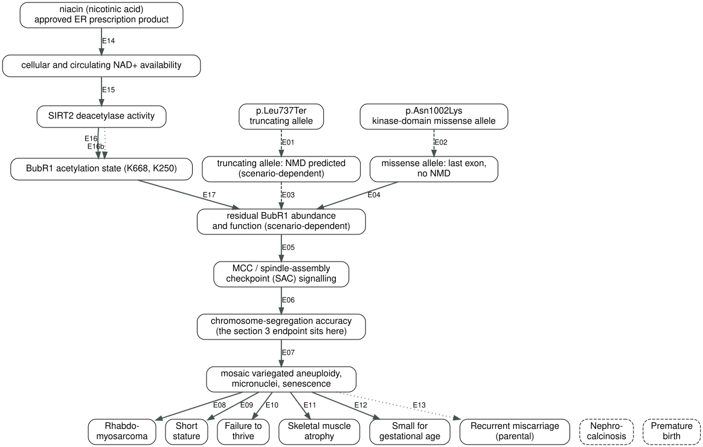

# Mechanism chain

Strength legend (weakest last): measured_in_proband · measured_in_model · predicted · asserted

| Edge | From → To | Claim | Strength | Model (genotype match) | Sources | Counter-evidence | Scenario-dependent |
|---|---|---|---|---|---|---|---|
| E01 | V1 → T1 | The premature termination codon sits in exon 17 of 23, 748 nt upstream of the last exon junction, and triggers no escape rule, so NMD is predicted. | predicted | GTF arithmetic + the 50-55 nt rule (escape rules as implemented in aenmd) (same_variant) | docs/transcript_facts_public.yaml (variants[0].coding.nmd_class) | If the transcript escapes NMD (scenario S3) this edge does not hold; not measured in patient RNA. | yes |
| E02 | V2 → T2 | The missense variant lies in the last exon (23/23) and therefore does not meet the conditions that trigger NMD. | predicted | GTF arithmetic (same_variant) | docs/transcript_facts_public.yaml (variants[1]) | — | no |
| E03 | T1 → P | An allele degraded by NMD contributes no protein, so full-length BubR1 can come only from the missense allele. | predicted | inferred from E01 (same_variant) | docs/transcript_facts_public.yaml (variants[0].coding) | Under scenario S3 a truncated product exists and may act as a dominant negative. | yes |
| E04 | T2 → P | In MVA, the missense allele's protein turns over rapidly and total BUBR1 abundance falls; substitutions of this class consistently occur in or near the kinase domain. The structural basis is that the BUBR1 kinase domain is a pseudokinase — the human protein retains the catalytic triad but catalysis is dispensable for accurate segregation, and the residues that would bind ATP instead govern conformational stability — so a substitution there destabilises the fold rather than abolishing catalysis. | measured_in_model | MVA patient-derived cell lines + functional protein replacement; catalytically dead human BUBR1 mutants (same_gene_LoF) | PMID 20516114 (main text; two-class analysis); PMID 22698286 (main text); PMID 33207204 (main text); PMID 42434306 (Results: two novel heterozygous BUB1B missense variants (p.W722R, p.A739S); Western blot shows a trend toward reduced BUBR1 protein; PCS rates significantly elevated vs 20 controls by G-banding and centromere PNA-FISH) | Suijkerbuijk 2010 separates MVA mutations into two classes: those that lower protein abundance, and those that specifically impair checkpoint activity or microtubule attachment. That a kinase-domain missense belongs to the first class is the paper's generalisation, not a measurement on this allele — The abstract's direction is abundance-class => kinase-domain location. The body does assert the converse (Results heading and Fig. 3: 'All kinase domain-localized mutations in BUBR1 reduce overall BUBR1 protein abundance'; repeated in the Discussion), but that universal is quantified over the five kinase-domain substitutions from British MVA patients the paper actually tested, not over arbitrary novel variants; and Fig. 2A shows an N-terminal TPR-domain substitution lowering abundance as well, less steeply (2-6 fold across all patient lines), so it reads as a gradient rather than two clean bins. This child's substitution was not among those tested. Gama Braga 2020 (PMID 33207204) cuts the other way: the pseudokinase domain is itself required for KARD phosphorylation and PP2A-B56 recruitment, and mutating it directly causes impaired checkpoint silencing and alignment errors — so a substitution inside the domain may well be a function lesion rather than an abundance problem (scenario S2). The literature cannot assign this case to either class. One human data point from outside the Suijkerbuijk panel was added in 2026, and it points in this edge's direction without settling the two-class question: Li 2026 (PMID 42434306) found two novel BUB1B missense variants in the probands of two unrelated recurrent-pregnancy-loss families, with PCS rates in lymphocytes significantly above 20 controls and a Western-blot "trend toward reduced" BUBR1 protein. The bounds matter and are stated rather than buried: both probands are **heterozygous**, not biallelic; both variants are VUS under ACMG/AMP; the protein result is a trend, not a quantified fall; n = 2; and p.W722R and p.A739S both sit **N-terminal to** the kinase domain (766-1050) rather than inside it. So it tests whether a missense near the domain lowers abundance, not whether a missense inside the domain belongs to the abundance class. No published dataset has measured this child's substitution. | yes |
| E05 | P → C | Cells from biallelic MVA patients have low total BUBR1 and show an impaired checkpoint with chromosome-alignment defects; critically, ectopic expression of BUBR1 restores checkpoint activity — establishing that BUBR1 insufficiency is what causes the segregation errors in patients, and that raising BUBR1 is a viable intervention point in patient cells. | measured_in_model | MVA patient-derived cell lines + ectopic BUBR1 rescue (same_gene_LoF) | PMID 20516114 (main text; ectopic BUBR1 restores checkpoint) | The rescue used ectopic wild-type BUBR1, not a drug raising the endogenous protein; one step still separates the two. (2026-10-19 adversarial review: this edge previously listed PMID 19407811 as a second source. That paper studies how BubR1 acetylation at prometaphase modulates APC/C activity and mitotic timing in normal cells — no MVA patient cells, no abundance measurement, no ectopic rescue. It does not support this edge and has been removed; it supports the acetylation–stability edges E16/E17 instead.) | yes |
| E06 | C → F | A weakened SAC lets cells enter anaphase before chromosomes are correctly attached, lowering segregation accuracy. | measured_in_model | biallelic BUB1B patient cells (PCS / MVA) (same_gene_LoF) | PMID 15475955 (main text); PMID 10877982 (main text) | — | no |
| E07 | F → O | Persistent segregation errors give different cells different chromosome complements, producing mosaic variegated aneuploidy and micronuclei, and driving cellular senescence. | measured_in_model | BubR1-low mice and MVA patient cells (same_gene_LoF) | PMID 15208629 (main text); PMID 31738183 (Fig 8. Erratum PMID 33136097. NB the mouse allele L1002P models HUMAN L1012P, which is a different residue from this case); PMID 24981203 (main text) | The aneuploid fraction does not rank monotonically with disease severity (Sieben 2020), so it cannot stand alone as a primary efficacy endpoint. | no |
| E08 | O → H1 | Aneuploidy arising from chromosomal instability raises embryonal tumour risk; rhabdomyosarcoma is within the tumour spectrum already reported in MVA. | measured_in_model | MVA patient series and BubR1 mouse tumour models (same_gene_LoF) | PMID 15475955 (main text); PMID 23242215 (main text) | — | no |
| E09 | O → H3 | BubR1-insufficient mice show dwarfing and growth retardation, corresponding to short stature in humans. | measured_in_model | BubR1-low mice (H/H) (same_gene_LoF) | PMID 15208629 (Fig 2) | — | no |
| E10 | O → H4 | The same growth-retardation mechanism presents as poor weight gain. | measured_in_model | BubR1-low mice (H/H) (same_gene_LoF) | PMID 15208629 (Fig 2) | — | no |
| E11 | O → H5 | BubR1 insufficiency causes sarcopenia; Sieben 2020 shows the sarcopenia tendency in monoallelic carriers correlates with mTORC1 hyperactivity. | measured_in_model | skeletal muscle of BubR1-low mice (same_gene_LoF) | PMID 15208629 (main text); PMID 31738183 (Fig 6. Erratum PMID 33136097. NB the mouse allele L1002P models HUMAN L1012P, which is a different residue from this case) | — | no |
| E12 | O → H7 | BubR1-null mouse embryos have more than half their cells aneuploid shortly after implantation, with growth retardation and widespread random apoptosis — so prenatal growth restriction connects directly to the same segregation-failure mechanism, with no extrapolation from postnatal data. | measured_in_model | BubR1(-/-) mouse embryos (E7.5-13.5) (same_gene_LoF) | PMID 24981203 (main text) | That model is a complete-loss, embryonic-lethal background, more severe than this case's hypomorph; the direction carries over, the magnitude does not. | no |
| E13 | O → H8 | The same segregation-failure mechanism acting on other conceptions would cause embryonic aneuploidy and miscarriage (measured in mouse). For humans, the source authors *predict* — from their mouse data and a re-analysis of published human data — that BubR1 deficiency explains a significant fraction of recurrent pregnancy loss; this is not a measurement. The parental recurrent-miscarriage observation is compatible with the same mechanism. | asserted | BubR1(-/-) mouse embryos (measured) + the authors' prediction for human RPL (same_gene_LoF) | PMID 24981203 (abstract: "we predict that deficiency/insufficiency of BubR1 ... are responsible for a significant fraction of both early and late RPLs"); PMID 42434306 (Methods/Results: two unrelated unexplained-RPL families; chromosomal microarray of six miscarriage specimens showed random aneuploidies; WES found heterozygous BUB1B p.W722R and p.A739S; PCS significantly elevated vs 20 controls; Discussion: "first clinical evidence suggesting that heterozygous BUB1B variants may impair SAC fidelity, leading to somatic PCS and recurrent embryonic aneuploidy") | This is a parental observation, not a phenotype of the proband's cells. More importantly, the human half of Schmid 2014 is the authors' prediction rather than a measurement (2026-10-19 adversarial review found this edge labelled measured_in_model, which is exactly the error this submission claims to guard against); the strength has been lowered to asserted. With PMID 42434306 added on 2026-10-20, the human end of this link now has a clinical and cytogenetic measurement for the first time: miscarriage specimens from BUB1B heterozygous carriers showed random aneuploidies and the carriers' lymphocytes showed significantly elevated PCS. **The edge's strength nevertheless stays `asserted`**, because the weakest link has not moved: the parents in this family were never tested, so attributing their losses to BUB1B insufficiency remains an inference. Li 2026 carries its own bounds — both variants are VUS, n = 2, and the authors claim only "preliminary functional support". | no |
| E14 | D1 → D2 | In adults, oral niacin escalated from 250 mg/day by 250 mg every four weeks to 750-1,000 mg/day (14-18 mg/kg) raised blood NAD+ up to 8-fold, and patients' muscle NAD+ reached the level of their controls. | measured_in_model | open-label study in adults with mitochondrial myopathy and matched controls (NCT03973203) (not_applicable) | PMID 32386566 (abstract; Methods/Fig 1A dose escalation) | The subjects are adults, not children. Systemic NAD+ repletion is not uniform -- the rise in blood was substantially larger than in muscle -- so a blood NAD+ response does not establish that the relevant tissue reached a BubR1-stabilising exposure. Note also that the muscle result is normalisation to control level, not a measured fold-rise. | no |
| E15 | D2 → D3 | SIRT2 is an NAD+-dependent deacetylase whose activity tracks NAD+ availability; the NAD+ precursor NMN raises BubR1 protein levels in vivo. | measured_in_model | mice and mouse embryonic fibroblasts (not_applicable) | PMID 24825348 (main text; NMN administration) | The in vivo NMN work was done on a wild-type background (wild-type mice; WT and Sirt2-/- MEFs), not on a BUB1B-mutant background. The molecule proposed here is niacin, not NMN, and that bridge is untested. | no |
| E16 | D3 → D4 | SIRT2 deacetylates BubR1 at K668, opposed by the CBP acetyltransferase. | measured_in_model | mouse tissues and cells; site-specific mutants (K668Q / K668R as acetyl-mimetic / non-acetylatable) (not_applicable) | PMID 24825348 (main text; K668 site mapping) | K668Q and K668R are acetylation-mimetic mutants, not this child's disease-causing missense; the paper uses no BUBR1 missense mutant and no MVA patient cell anywhere. The K668 axis has no independent replication in PubMed (checked 2026-10-19: (BubR1 OR BUB1B) AND (K668 OR "lysine 668") returns this paper only). | no |
| E16b | D3 → D4 | The same enzyme acts on a second BubR1 lysine. SIRT2 deacetylates K250 in vitro and in vivo, and acetylation at K250 (by PCAF) blocks ubiquitin-dependent degradation. The decisive qualifier: when Suematsu 2014 knocked SIRT2 down, K250 acetylation rose but that increase was "not substantial to elevate the levels of total BubR1 or delay the transition from prometaphase to anaphase". So this is an established enzyme-site relationship, NOT an established opposing effect on BubR1 abundance. | measured_in_model | human cells; both K250 acetylation/degradation and SIRT2-K250 deacetylation measured (not_applicable) | PMID 19407811 (main text; K250 acetylation blocks ubiquitin-dependent degradation; K250Q/K250R); PMID 25285631 (abstract: SIRT2 deacetylates BubR1 K250 in vitro and in vivo; SIRT2 knockdown raises K250 acetylation but that increase is not substantial to elevate total BubR1 or delay the prometaphase-to-anaphase transition) | This edge was rewritten once, on the evening of 2026-10-19, after we obtained the primary abstract. We had been wrong in BOTH directions: we under-graded the enzyme-site link as asserted, and we over-stated it as an opposing effect on BubR1 ABUNDANCE. The source shows SIRT2 knockdown raises K250 acetylation without changing total BubR1 -- which WEAKENS K250 as a counter-argument rather than strengthening it, and we record that because the correction runs in our own favour. Evidence from a third site makes the picture harder, not easier: Qiu 2018 (PMID 29067790) shows that in mouse oocytes the NON-acetylatable BubR1-K243R is the beneficial allele, lowering the incidence of aneuploid eggs from aged mice -- and mouse K243 is plausibly the same conserved residue as human K250 under different numbering. One enzyme, at least three sites, and the consequences for stability and for the endpoint do not agree. | no |
| E17 | D4 → P | K668 deacetylation protects BubR1 from proteasomal degradation and raises its abundance; a SIRT2 transgene extends the lifespan of BubR1-H/H mice (median +58%). | measured_in_model | BubR1-H/H mice (a low-abundance but otherwise normal protein) + a SIRT2 transgene (same_gene_other) | PMID 24825348 (main text; Fig 4 lifespan); PMID 38009412 (main text; SIRT2 overexpression on a normal background) | This is the most load-bearing and most fragile step in the hypothesis. (1) Different substrate class: the residual protein in BubR1-H/H is a low-abundance but otherwise normal protein, whereas this case's residual protein is a misfolded missense product; deacetylation that protects a normal protein from degradation need not rescue one being cleared because it is misfolded. (2) Background specificity: SIRT2 overexpression does nothing to health or lifespan on a normal background (Wu 2023), which narrows the claim to a BubR1-low setting and means no general evidence supports it. (3) No E3 ligase is named, so it cannot be determined whether the degradation route K668 acetylation protects against is the same route that destroys a misfolded kinase-domain mutant -- this is the joint at which the whole hypothesis is most likely to fail. (4) See E16b: the same enzyme acts in the opposite direction at K250. The net effect in this background is unmeasured. | yes |

## Phenotypes not explained by the current chain

- Nephro-
calcinosis (HP:0000121)
- Premature
birth (HP:0001622)

## Node key

| Node | Level | Label |
|---|---|---|
| V1 | variant | p.Leu737Ter
truncating allele |
| V2 | variant | p.Asn1002Lys
kinase-domain missense allele |
| T1 | transcript | truncating allele: NMD predicted
(scenario-dependent) |
| T2 | transcript | missense allele: last exon,
no NMD |
| P | protein | residual BubR1 abundance
and function (scenario-dependent) |
| C | complex | MCC / spindle-assembly
checkpoint (SAC) signalling |
| F | cellular_process | chromosome-segregation accuracy
(the section 3 endpoint sits here) |
| O | cellular_outcome | mosaic variegated aneuploidy,
micronuclei, senescence |
| H1 | phenotype | Rhabdo-
myosarcoma |
| H2 | phenotype | Nephro-
calcinosis |
| H3 | phenotype | Short
stature |
| H4 | phenotype | Failure to
thrive |
| H5 | phenotype | Skeletal muscle
atrophy |
| H6 | phenotype | Premature
birth |
| H7 | phenotype | Small for
gestational age |
| H8 | phenotype | Recurrent miscarriage
(parental) |
| D1 | intervention | niacin (nicotinic acid)
approved ER prescription product |
| D2 | metabolite | cellular and circulating NAD+ availability |
| D3 | enzyme | SIRT2 deacetylase activity |
| D4 | ptm | BubR1 acetylation state (K668, K250) |

## Wording constraints (rule 4)

- E04: rule 4 - this measured claim rests on premise T2, which is supported only by predicted/asserted edges, so the report must word it as "if T2 holds"

