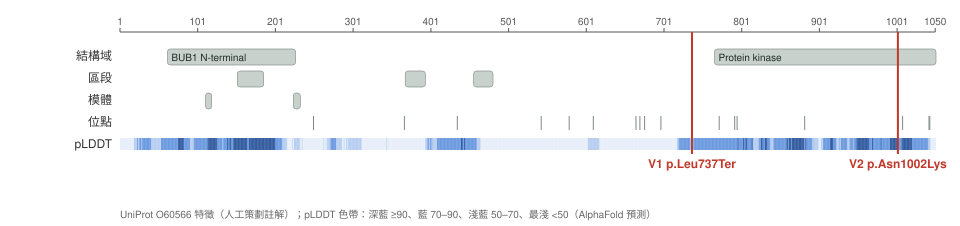

# BUB1B protein domain map (UniProt O60566, 1050 aa)

Generated by `scripts/phase1/12_domain_map.py` from `docs/transcript_facts_public.yaml`.

- Sequence identity (UniProt canonical vs MANE transcript translation): **identical**
- AlphaFold: AF-O60566-F1 v6

| Variant | Class | Residue | Feature at that residue | Experimental / natural variation at the same residue | Features lost downstream | pLDDT (mean +/-5) |
|---|---|---|---|---|---|---|
| V1 ENSP00000287598.7:p.Leu737Ter | stop_gained | 737 | — | — | Protein kinase (766–1050) | 73.56 (75.0) |
| V2 ENSP00000287598.7:p.Asn1002Lys | missense | 1002 | Domain: Protein kinase (766–1050) | — | — | 91.06 (89.6) |

## How far this can be read

- A low pLDDT does not mean a region is unimportant: disordered segments are often functional.
- UniProt features are annotation, not an experiment on this patient, and feature boundaries are drawn by hand.
- For a truncating variant, 'features lost downstream' is a structural inference. Whether any protein exists at all depends on the NMD prediction in report section 2 and on the scenarios in section 8.
